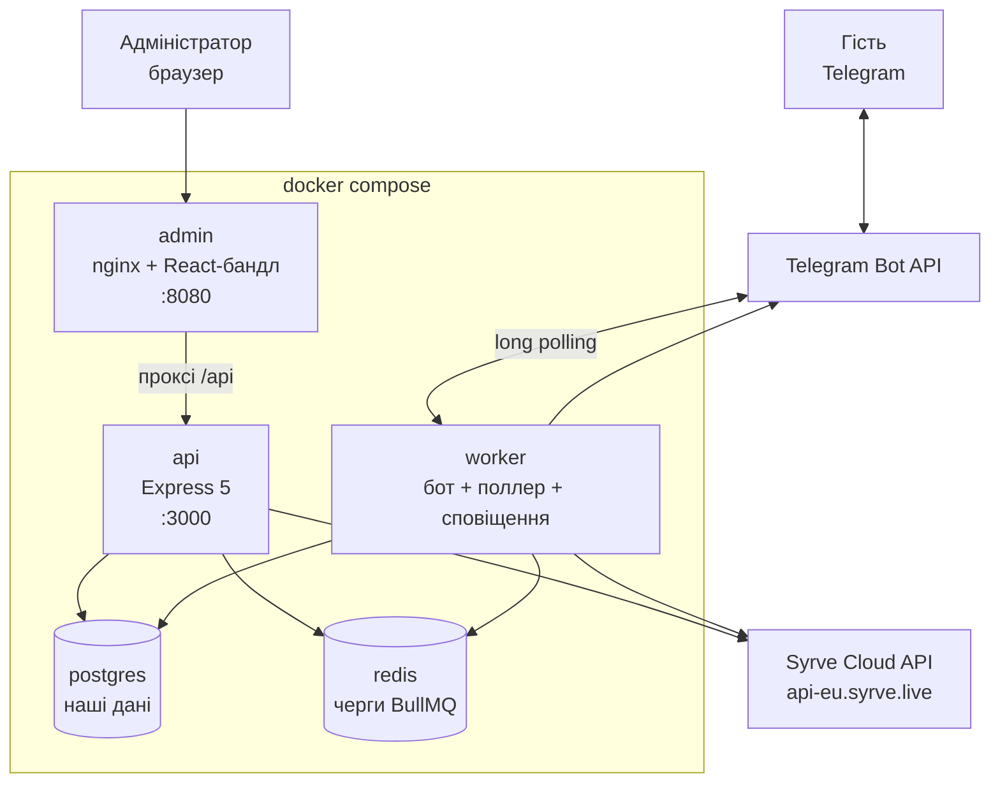
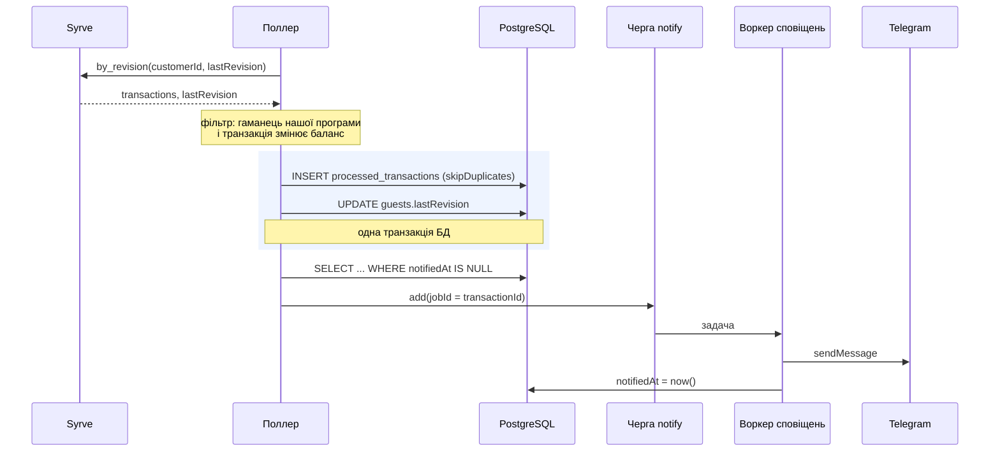

# Архітектура

## З яких частин складається



| Частина | Процес | Відповідальність |
|---|---|---|
| `api` | HTTP-сервер | REST для панелі: вхід, пошук гостя, нарахування й списання, журнали |
| `worker` | окремий процес, без HTTP-порту | Telegram-бот (long polling), поллер транзакцій Syrve, відправка сповіщень |
| `admin` | nginx | віддає зібрану React-панель і проксує `/api` на `api` |
| `postgres` | — | те, чого немає в Syrve: адміністратори, зв'язок Telegram ↔ гість, журнал операцій, стан синхронізації |
| `redis` | — | черги BullMQ: розклад поллера, черга сповіщень, стан діалогу реєстрації, лімітер входу |

**Чому `api` і `worker` — окремі процеси.** Long polling Telegram і поллер Syrve працюють постійно, незалежно від HTTP-запитів. У спільному процесі падіння чи перезапуск API зривало б і бота; крім того, API можна масштабувати кількома копіями, а поллер має бути один, інакше гості отримають дублі. Образ у них один — відрізняються лише командою запуску.

**Чому nginx, а не віддача статики з Express.** JWT лежить у httpOnly cookie. Коли сторінка й API на одному origin, браузер надсилає cookie без CORS і без `SameSite=None` — це і простіше, і безпечніше. У режимі розробки ту саму роль грає проксі Vite.

---

## Які дані зберігаємо самі, а які беремо з Syrve

Головне правило: **баланс, картки й транзакції належать Syrve**. Сервіс їх не дублює — інакше з'явилося б два джерела правди, і при будь-якій операції на касі наша копія ставала б брехнею.

| Зберігаємо самі (PostgreSQL) | Навіщо |
|---|---|
| `admins` — логін, bcrypt-хеш пароля | у Syrve немає адміністраторів нашої панелі |
| `guests` — `telegramId`, `chatId`, телефон, `syrveCustomerId`, номер картки, `lastRevision`, `botBlockedAt` | Syrve не знає про Telegram; це єдиний зв'язок між акаунтом у Telegram і гостем у Syrve |
| `operations` — хто, коли, скільком, скільки, чому, результат | у Syrve є факт зміни балансу, але немає відповіді «який адміністратор і чому»; невдалі спроби теж записуємо — це аудит |
| `processed_transactions` — які транзакції Syrve вже оброблено й чи надіслано сповіщення | захист від повторних сповіщень |
| `mock_customers`, `mock_transactions` | лише для `SYRVE_MODE=mock` |

| Беремо з Syrve | Метод |
|---|---|
| гість: ім'я, телефон, картки, баланси гаманців | `customer/info` (`type: phone` або `type: id`) |
| створення/оновлення гостя | `customer/create_or_update` |
| додавання в програму, видача картки | `customer/program/add`, `customer/card/add` |
| нарахування й списання | `customer/wallet/topup`, `customer/wallet/chargeoff` |
| історія транзакцій | `customer/transactions/by_revision` |
| організація та програма лояльності | `organizations`, `loyalty/syrve/program` |

Дублювання балансу в себе було б найпростішим рішенням і найгіршим: нарахування на касі не проходить через наш сервіс, тому локальна копія розходилася б із реальністю мовчки.

---

## Обмін із Syrve

Увесь обмін ізольований у `api/src/services/syrve/`. Решта коду не знає ні про HTTP, ні про формати Syrve — вона викликає методи інтерфейсу `SyrveClient`.

```
services/syrve/
  types.js        контракт SyrveClient (базовий клас + JSDoc-типи)
  realClient.js   справжній клієнт
  mockClient.js   мок із тим самим інтерфейсом
  errors.js       нормалізовані помилки
  index.js        фабрика за SYRVE_MODE
```

**Токен.** `POST /api/1/access_token` з `apiLogin` → токен на годину. Кешується в пам'яті процесу; оновлюється за 5 хвилин до закінчення. Паралельні запити не плодять токенів: якщо запит токена вже летить, усі чекають на нього (single-flight).

**Відповідь 401.** Один повтор зі свіжим токеном — і все. Якщо ключ непридатний, другий повтор нічого не змінить, а нескінченний цикл поклав би сервіс.

**Таймаут.** 15 секунд на запит. Без нього зависання Syrve підвісило б і наш запит, і — у випадку операцій — транзакцію бази разом із блокуванням гостя.

**Нормалізація помилок.** Syrve віддає помилки у двох різних форматах: транспортні методи — `{correlationId, errorDescription}`, методи лояльності — `{code, errorCode, message, description}`. Клієнт читає обидва й перетворює у свої типи:

| Тип | Коли | Як реагує сервіс |
|---|---|---|
| `SyrveAuthError` | 401/403 | 503 і підказка перевірити `SYRVE_API_LOGIN` |
| `SyrveNotFoundError` | 404, або 400 `Transport_WrongCustomerNumber` («гостя немає») | пошук повертає `null`, панель — 404 українською |
| `SyrveValidationError` | решта 4xx | 409, операція не виконується |
| `SyrveUnavailableError` | таймаут, мережа, 5xx, 429 | 503, «спробуйте пізніше» |

Текст від Syrve користувачу не показується: у транспортному форматі він повторює `apiLogin`. У лог ідуть лише тип, статус і `correlationId`, за яким Syrve знайде запит у себе. Поле `apiClientLogin`, яке приходить у транзакціях, додане в `redact` логера.

**Мок.** Той самий інтерфейс, дані — в окремих таблицях (а не в пам'яті, бо `api` і `worker` — різні процеси, і в пам'яті вони не побачили б операцій один одного). Мок свідомо повторює незручні особливості живого API: числові коди типів транзакцій, `balanceAfter = null` у нейтральних транзакціях, великі номери ревізій і те, що **списання понад баланс не відхиляється**. Мок, який поводиться краще за реальність, створює ілюзію захисту — і помилка знаходиться вже на демонстрації.

---

## Обмін із Telegram

grammY, **long polling**, у процесі `worker`. Вебхуки потребують публічного HTTPS-адреса — для сервісу, який запускається локально однією командою, це зайва умова. Той самий екземпляр бота використовується у двох ролях: слухає команди гостя й надсилає сповіщення з черги.

**Стан діалогу реєстрації — у Redis** із TTL годину. У пам'яті процесу він губився б при кожному перезапуску воркера: гість, який уже надіслав контакт, мусив би починати з нуля.

**Підтвердження номера.** Телефон приймається лише кнопкою «Надіслати контакт», і лише якщо `contact.user_id === from.id`. Інакше можна було б переслати боту чужий контакт і зареєструвати чужий номер. Номер нормалізується до `+380XXXXXXXXX` — у БД і Syrve він має бути в одному вигляді, інакше той самий гість задублюється.

**Помилки бота** перехоплює `bot.catch`: без нього будь-яка помилка в обробнику зривала б long polling, і бот тихо перестав би відповідати.

---

## О6 — сповіщення про зміну балансу

### Чому polling, а не вебхуки

Syrve не надсилає вебхуків про зміну бонусного балансу. Єдиний спосіб дізнатися про нарахування, зроблене на касі або в кабінеті Syrve Loyalty, — періодично питати самому.

### Чому курсор на кожного гостя

`customer/transactions/by_revision` вимагає `customerId` — метод працює для **одного** гостя. Тому `lastRevision` зберігається в рядку гостя, а не глобально. Прохід поллера — цикл по гостях, у яких є `syrveCustomerId` і яких не заблоковано.

Ревізії в Syrve — великі 64-бітні числа (у тестовій організації вже ~5 203 511 329), тому `revision` і `lastRevision` — `BigInt`. У `Int` (максимум 2 147 483 647) вони не вміщуються, і поллер зламався б на живих даних.

### Базова лінія при реєстрації

Одразу після реєстрації `lastRevision` ставиться на поточну останню ревізію гостя. Інакше новий гість, який уже приходив на касу, отримав би пачку сповіщень про операції, яких не очікував.

### Один коміт і outbox



Три рівні захисту від дублів і втрат:

1. **Один коміт.** Вставка нових `processed_transactions` і зсув `lastRevision` — в одній транзакції бази. Інакше можливі дві біди: курсор зсунувся, а записів немає (сповіщення втрачено назавжди), або записи є, а курсор ні (наступний прохід прочитає те саме).

2. **`transactionId UNIQUE` + `skipDuplicates`.** Та сама транзакція вдруге не вставиться на рівні бази.

3. **Outbox.** У чергу кладеться не те, що прочитали з Syrve, а те, що **вже лежить у базі** з `notifiedAt IS NULL`. Якщо процес упав між комітом і постановкою в чергу, наступний прохід усе одно підбере ці записи. `jobId = transactionId`, тому BullMQ відкидає дублікат задачі; а воркер перед відправкою ще раз перевіряє `notifiedAt`.

`notifiedAt` ставиться **після** успішної відправки: якщо позначити раніше й відправка впаде, гість не дізнається про бонуси зовсім. Зайве повідомлення — менша біда, ніж загублене, але до зайвого й не доходить завдяки перевірці.

### Напрямок — за знаком суми

Напрямок повідомлення («нараховано» чи «списано») визначає **знак `sum`**, а не тип транзакції. Таблиця типів відповідає лише на інше питання: чи ця транзакція взагалі змінює баланс (нейтральна — `21 SetGuestCategory`, у неї `sum = 0` і `balanceAfter = null`).

Причина: типів у Syrve більше, ніж видно на тестовій організації, і назва не гарантує напрямку. Операція «Змінення балансу» з кабінету приходить як `7 RefillWallet` — ні `35`, ні `40`, якими позначені операції через API. За знаком суми новий, невідомий тип одразу обробляється правильно; мапінг за назвами вимагав би правки коду на кожен новий тип.

### Фільтр за `walletId`

Гість може бути в кількох програмах одночасно (у тестовій організації їх чотири), і `by_revision` віддає транзакції всіх гаманців. Беруться лише ті, що стосуються гаманця нашої програми — інакше гість отримав би «баланс» чужої програми.

### Блокування бота

Telegram відповідає `403`, коли гість заблокував бота. Задача знімається без ретраїв (`UnrecoverableError`), гість позначається `botBlockedAt`, і поллер його більше не опитує. Решта помилок (мережа, 429, 5xx) — звичайний ретрай: 3 спроби з наростаючою затримкою.

---

## Захист від списання понад баланс

Перевірено на живому API: **Syrve дозволяє списати більше, ніж є на балансі** — баланс спокійно пішов у −999 993 (`docs/api-samples/10-chargeoff-over-balance.json`). Отже, єдиний захист — наш.

```
prisma.$transaction:
  SELECT pg_advisory_xact_lock(hashtext(customerId))   ← лок на цього гостя
  customer/info                                        ← свіжий баланс із Syrve
  якщо списання > баланс → 409, операція не виконується
  customer/wallet/chargeoff
коміт
```

**Чому баланс читається перед кожною операцією**, а не беремо збережений: баланс живе в Syrve і міг змінитися на касі секунду тому.

**Чому advisory lock, а не лок у Redis:** він тримається до кінця транзакції бази й знімається сам навіть при падінні процесу — ручний лок у Redis треба не забути віддати. `hashtext` потрібен, бо advisory-локи приймають числа, а id гостя — uuid.

**Чому це працює:** без лока два одночасні списання по 100 з балансу 150 обидва пройшли б перевірку, і баланс став би −50. Перевірка на трьох паралельних списаннях по 50 з балансу 110 дає `200 / 409 / 200` і баланс 10.

Журнал операцій пишеться **поза** цією транзакцією: усередині запис про невдалу спробу відкотився б разом із нею, і відмови не лишали б слідів.

---

## Чому такий стек

| Рішення | Причина |
|---|---|
| **Монорепо** | `api` і `admin` версіонуються разом: зміна формату відповіді одразу видна в типах панелі. Один репозиторій — одне посилання на здачу й один `docker compose up` |
| **Express 5 + Joi** | перевірена структура (`routers` → `controllers` → `services`), валідація на межі, нічого зайвого |
| **PostgreSQL + Prisma** | реляційні зв'язки (гість → операції, гість → транзакції), міграції в Git, типізований клієнт. Зміни схеми — лише міграціями, їх сім |
| **Redis + BullMQ** | потрібні три речі одночасно: повторювана задача за розкладом, черга з ретраями й ідемпотентність через `jobId`. Усе це BullMQ дає з коробки |
| **grammY** | сучасна бібліотека Telegram Bot API з нормальною типізацією й зручним `Keyboard` |
| **React + Vite + TypeScript** | типи ловлять розбіжності з API на етапі збірки; панель невелика, тому без бібліотеки компонентів — власний CSS на ~300 рядків |
| **Docker Compose** | вимога ТЗ: весь сервіс однією командою, з міграціями й сідом усередині |

---

## Обмеження й що робив би далі

Чесно про межі зробленого.

**Поллер — O(кількість гостей).** Кожен прохід робить мінімум один запит до Syrve на кожного гостя, бо `by_revision` вимагає `customerId`. На сотні гостей і 30-секундному інтервалі це вже тисячі запитів на годину. Що робити: розбивати гостей на групи й опитувати активних частіше за «спящих»; додати експоненційне відставання для тих, у кого давно не було операцій; за наявності — перейти на звіт за всією організацією замість обходу гостей. У поточному обсязі (тестова організація, демонстрація) обмеження не проявляється.

**Історія операцій гортає всі транзакції гостя.** `by_revision` віддає сторінками від заданої ревізії, тому «останні 10» збираються з повного списку й розвертаються. Для десятків операцій на гостя це нормально; на тисячах потрібен `transactions/by_date` з періодом — метод існує, але перевірити його на реальних даних тестової організації не вдалося, тому залишено те, що точно працює.

**Один адміністратор без ролей.** `Д10` (власник і менеджер із різними правами, журнал дій адміністраторів) не робилося. Журнал операцій уже пише, хто саме виконав дію, тож ролі — це перевірка прав у `authenticate` і таблиця ролей.

**Mini App не робився** (`Д3`). Бот покриває ті самі функції; Mini App дав би приємніший інтерфейс, але вимагав би перевірки підпису `initData` і публічного HTTPS.

**Вебхуки Telegram замість long polling.** У продакшені вебхуки економніші, але вимагають публічного HTTPS-адреса; для локального запуску однією командою long polling зручніший.

**Автотестів немає.** Замість них — два скрипти перевірки (`api/scripts/check-syrve-real.mjs`, `api/scripts/check-notifications.mjs`), які проходять сценарії наскрізь по справжній базі, чергах і воркерах. Для тестового завдання за один день це був свідомий вибір: вони перевіряють саме те, що ламається (дублі сповіщень, гонки, формати Syrve), і їх видно в роботі. Далі потрібні звичайні юніт-тести на нормалізацію телефону, класифікацію типів транзакцій і розбір помилок Syrve, та інтеграційні — на `applyOperation` і поллер.

**`v1 access_token` позначений deprecated.** ТЗ видає саме `apiLogin`, який працює з v1, тому використовується v1. Міграція на новий спосіб авторизації — коли Syrve опише його для видаваних ключів.
